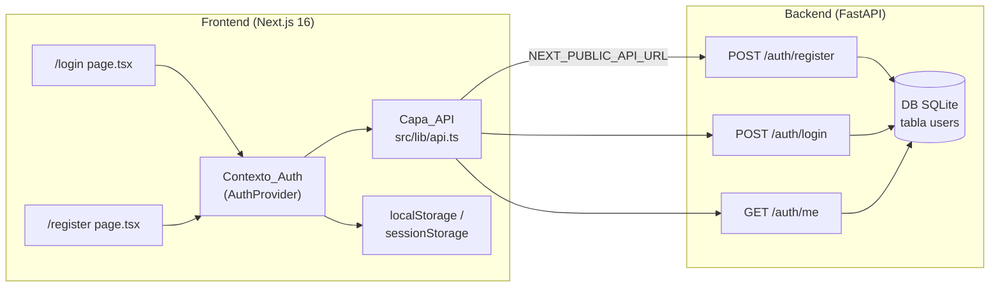
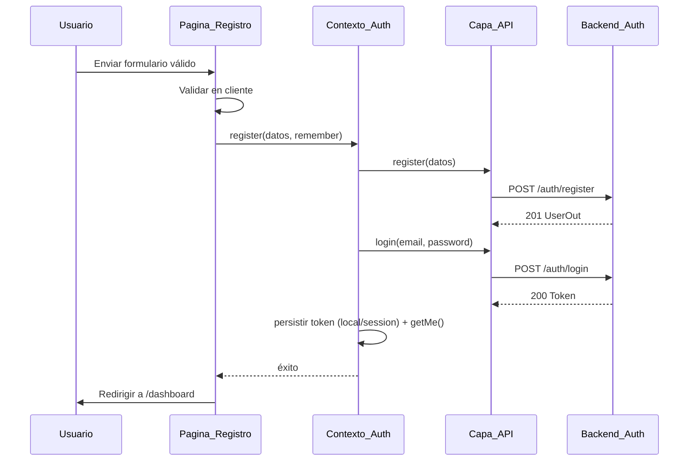
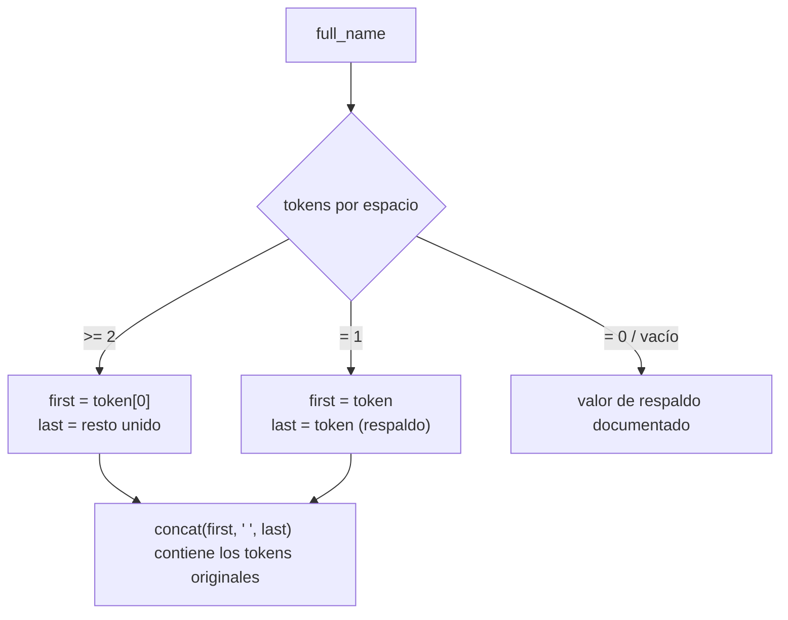

# Documento de Diseño

## Overview

Esta funcionalidad añade autenticación completa a "English Assistant": dos páginas de frontend (`/login` y `/register`) construidas sobre Next.js 16 (App Router, React 19, Tailwind CSS v4) y una ampliación del backend FastAPI existente para capturar nombre, apellido y nivel de inglés por separado.

El diseño se apoya en la infraestructura ya presente:

- **Backend** (`backend/app`): FastAPI + SQLAlchemy 2.0, JWT HS256 con caducidad de 30 minutos, hashing Argon2 (passlib). Ya existen `POST /auth/register`, `POST /auth/login` y `GET /auth/me`. El subject del token JWT es el correo del usuario.
- **Frontend** (`frontend/src`): App Router con `layout.tsx` global (Navbar, Footer, HelpButton), paleta de marca definida en `globals.css` (`brand-900`, `brand-700`, `brand-500`, `accent-500`, `accent-600`, `sky-soft`) y componentes reutilizables (`Logo`, `Navbar`).

Los cambios principales son:

1. **Backend**: reemplazar `full_name` por `first_name`, `last_name` y `english_level` (enum A1–C2), con una conversión de los registros existentes sin pérdida de datos. Actualizar los esquemas Pydantic y las respuestas de los tres endpoints.
2. **Frontend**: una capa de API centralizada en `src/lib`, un `Contexto_Auth` basado en React Context que gestiona el token y el usuario actual, y las páginas `/login` y `/register` con validación en el cliente y manejo de errores del backend.

### Decisiones de diseño clave

- **Token en `localStorage`/`sessionStorage` + React Context** (no cookie `httpOnly`): la cookie `httpOnly` queda como mejora futura (requisito 10 / Notas). La elección del almacenamiento depende del checkbox "Recordarme" (requisito 8).
- **El subject del JWT sigue siendo el correo**: no se modifica `security.py`; la ampliación del modelo no afecta a la emisión ni verificación del token.
- **Registro seguido de login automático**: tras un registro exitoso el frontend llama a `login()` para obtener el token e iniciar sesión sin pasos extra (requisito 5).
- **Nivel de inglés como enum compartido**: un único conjunto `{A1, A2, B1, B2, C1, C2}` se refleja en el modelo (SQLAlchemy `Enum`), el esquema Pydantic y el selector del frontend.

## Architecture

### Vista general



### Capas del frontend

El frontend separa responsabilidades en tres capas, lo que permite que cada una se pruebe y evolucione de forma aislada:

1. **Capa de presentación** (`src/app/login/page.tsx`, `src/app/register/page.tsx` y subcomponentes): renderiza el layout de dos columnas, los campos y los mensajes de error. No habla directamente con HTTP.
2. **Capa de estado de sesión** (`Contexto_Auth` en `src/context/AuthContext.tsx`): mantiene `{ token, user, status }`, decide dónde persistir el token y expone `register`, `login`, `logout` a las páginas.
3. **Capa de API** (`src/lib/api.ts`): encapsula `fetch`, construye las URLs desde `NEXT_PUBLIC_API_URL`, adjunta la cabecera `Authorization` y normaliza los errores.

### Flujo de registro (requisito 5)



### Flujo de arranque y rehidratación (requisito 8.3, 8.4)

Al montar `AuthProvider`, se lee el token (primero `localStorage`, luego `sessionStorage`). Si existe, se llama a `getMe()`:

- Éxito → se rehidrata `user` y el estado queda `authenticated`.
- Fallo por token caducado/ inválido → se limpian ambos almacenamientos, el estado pasa a `unauthenticated` y se expone una señal de "sesión expirada".

## Components and Interfaces

### Backend

#### Enum de nivel de inglés

Un único enum de Python reutilizado por el modelo y el esquema:

```python
# app/models/user.py (o app/models/enums.py)
import enum

class EnglishLevel(str, enum.Enum):
    A1 = "A1"
    A2 = "A2"
    B1 = "B1"
    B2 = "B2"
    C1 = "C1"
    C2 = "C2"
```

#### Router `auth.py`

Se mantiene la firma pública de los tres endpoints; solo cambia la forma de los datos:

- `POST /auth/register` → recibe `UserCreate` (con `first_name`, `last_name`, `english_level`), crea el `User`, responde `201` con `UserOut`. Conserva el `409` con `detail = "Ya existe una cuenta con ese correo."`.
- `POST /auth/login` → sin cambios funcionales; responde `Token` o `401` con `detail = "Correo o contraseña incorrectos."`.
- `GET /auth/me` → responde `UserOut` ampliado (incluye `first_name`, `last_name`, `english_level`).

La validación de longitudes y del enum la realiza Pydantic automáticamente, devolviendo `422` con el campo inválido señalado en `detail` (requisito 9.3).

### Frontend

#### Capa_API (`src/lib/api.ts`)

```typescript
// Tipos de datos
export type EnglishLevel = "A1" | "A2" | "B1" | "B2" | "C1" | "C2";

export interface RegisterInput {
  first_name: string;
  last_name: string;
  email: string;
  password: string;
  english_level: EnglishLevel;
}

export interface LoginInput {
  email: string;
  password: string;
}

export interface UserOut {
  id: number;
  first_name: string;
  last_name: string;
  email: string;
  english_level: EnglishLevel;
  created_at: string;
}

export interface TokenResponse {
  access_token: string;
  token_type: string;
}

// Error normalizado que la capa de API lanza en cualquier fallo
export class ApiError extends Error {
  status: number | null; // null => error de red/conexión
  constructor(message: string, status: number | null) {
    super(message);
    this.status = status;
  }
}

export function register(input: RegisterInput): Promise<UserOut>;
export function login(input: LoginInput): Promise<TokenResponse>;
export function getMe(token: string): Promise<UserOut>;
```

Comportamiento común (`request()` interno):

- Construye la URL como `${process.env.NEXT_PUBLIC_API_URL}${path}` (requisito 4.2).
- `getMe()` añade `Authorization: Bearer <token>` (requisito 4.5).
- Si la respuesta tiene estado de error, intenta leer `detail` del cuerpo JSON y lanza `ApiError(detail, status)` (requisito 4.6).
- Si `fetch` lanza (sin respuesta del servidor), lanza `ApiError(mensajeConexion, null)` (requisitos 7.3, 7.4).

#### Contexto_Auth (`src/context/AuthContext.tsx`)

```typescript
type AuthStatus = "loading" | "authenticated" | "unauthenticated";

interface AuthContextValue {
  user: UserOut | null;
  status: AuthStatus;
  sessionExpired: boolean;
  login: (input: LoginInput, remember: boolean) => Promise<void>;
  register: (input: RegisterInput, remember: boolean) => Promise<void>;
  logout: () => void;
}
```

El `AuthProvider` se insertará en `src/app/layout.tsx` envolviendo a `{children}` para que todas las páginas compartan el estado de sesión.

#### Almacenamiento del token (`src/lib/tokenStorage.ts`)

Módulo auxiliar que centraliza la política de persistencia (requisito 8):

```typescript
const KEY = "ea_access_token";

export function saveToken(token: string, remember: boolean): void;
// remember=true  -> localStorage.setItem(KEY, token) y limpia sessionStorage
// remember=false -> sessionStorage.setItem(KEY, token) y limpia localStorage

export function readToken(): string | null;
// lee de localStorage y, si no hay, de sessionStorage

export function clearToken(): void;
// elimina KEY de ambos almacenamientos
```

#### Páginas y subcomponentes

```
src/app/login/page.tsx        -> Pagina_Login (client component "use client")
src/app/register/page.tsx     -> Pagina_Registro (client component)
src/components/auth/
  AuthLayout.tsx              -> layout de dos columnas (panel de marca + tarjeta)
  BrandPanel.tsx              -> panel izquierdo con Logo y mensaje de marca
  PasswordField.tsx          -> input de contraseña con toggle mostrar/ocultar
  FormField.tsx              -> label + input + mensaje de error por campo
  LevelSelect.tsx            -> selector de Nivel_Ingles (A1..C2)
  CompletionMeter.tsx        -> indicador de porcentaje completado (registro)
```

Las páginas son client components porque necesitan estado local, validación en vivo y acceso al `Contexto_Auth`. `AuthLayout` y `BrandPanel` son presentacionales y reutilizan `Logo` y la paleta de `globals.css`.

> Nota: `AGENTS.md` del frontend advierte que esta versión de Next.js introduce cambios; durante la implementación se debe consultar `node_modules/next/dist/docs/` antes de usar APIs del App Router.

## Data Models

### Modelo `User` (SQLAlchemy) — estado objetivo

```python
class User(Base):
    __tablename__ = "users"

    id: Mapped[int] = mapped_column(Integer, primary_key=True, index=True)
    first_name: Mapped[str] = mapped_column(String(60), nullable=False)
    last_name: Mapped[str] = mapped_column(String(60), nullable=False)
    email: Mapped[str] = mapped_column(String(255), unique=True, index=True, nullable=False)
    english_level: Mapped[EnglishLevel] = mapped_column(
        SAEnum(EnglishLevel, native_enum=False), nullable=False
    )
    hashed_password: Mapped[str] = mapped_column(String(255), nullable=False)
    created_at: Mapped[datetime] = mapped_column(DateTime, server_default=func.now())
```

- `first_name` y `last_name`: longitud 2–60 (la cota superior la impone `String(60)` en BD y la inferior Pydantic).
- `english_level`: `Enum` no nativo (`native_enum=False`) para que funcione en SQLite, almacenado como texto `"A1".."C2"`.

### Esquemas Pydantic (`app/schemas/user.py`) — estado objetivo

```python
class UserCreate(BaseModel):
    first_name: str = Field(min_length=2, max_length=60)
    last_name: str = Field(min_length=2, max_length=60)
    email: EmailStr
    password: str = Field(min_length=8, max_length=128)
    english_level: EnglishLevel

class UserLogin(BaseModel):
    email: EmailStr
    password: str

class UserOut(BaseModel):
    id: int
    first_name: str
    last_name: str
    email: EmailStr
    english_level: EnglishLevel
    created_at: datetime
    model_config = ConfigDict(from_attributes=True)

class Token(BaseModel):
    access_token: str
    token_type: str = "bearer"
```

### Migración de `full_name` a `first_name` / `last_name` / `english_level` (requisito 9.6)

Como el proyecto usa SQLite con SQLAlchemy ORM y no tiene Alembic configurado, la conversión se realiza con un script de migración idempotente que:

1. Añade las columnas `first_name`, `last_name`, `english_level` si no existen.
2. Para cada fila con `full_name` no nulo, aplica la función de división de nombre:
   - Separa `full_name` por espacios en tokens no vacíos.
   - 0 tokens → `first_name = full_name` (o valor por defecto), `last_name = ""`? **No permitido** (mínimo 2 chars). Para filas antiguas se usa un valor de respaldo seguro (p. ej. `last_name = first_name` si falta) documentado en el script, de modo que no se pierdan registros.
   - 1 token → `first_name = token`, `last_name = token` (respaldo para cumplir obligatoriedad sin perder el dato original).
   - ≥2 tokens → `first_name = primer token`, `last_name = unión del resto por espacio`.
3. Asigna `english_level` por defecto `"A1"` a las filas migradas (no había dato previo).
4. Elimina (o deja de usar) la columna `full_name` tras copiar los datos.

La regla de división de nombres (`split_full_name(full_name) -> (first, last)`) es una función pura y es el núcleo verificable de la migración.



### API contract (resumen)

| Método | Ruta | Cuerpo entrada | Respuesta OK | Errores |
|--------|------|----------------|--------------|---------|
| POST | `/auth/register` | `{first_name, last_name, email, password, english_level}` | `201 UserOut` | `409` (correo duplicado), `422` (validación) |
| POST | `/auth/login` | `{email, password}` | `200 Token` | `401` (credenciales) |
| GET | `/auth/me` | — (header `Authorization: Bearer`) | `200 UserOut` | `401` (token inválido/caducado) |

## Correctness Properties

*Una propiedad es una característica o comportamiento que debe cumplirse en todas las ejecuciones válidas de un sistema: esencialmente, una afirmación formal sobre lo que el sistema debe hacer. Las propiedades son el puente entre las especificaciones legibles por humanos y las garantías de corrección verificables por máquina.*

Tras analizar los criterios de aceptación y aplicar la reflexión de propiedades (consolidando duplicados como la validación de correo en registro/login, la fidelidad de las peticiones y la política de almacenamiento del token), se derivan las siguientes propiedades. Cada una es universalmente cuantificada y verificable mediante pruebas basadas en propiedades.

### Property 1: Validación de formato de correo

*Para todo* valor de cadena introducido en el campo Correo electrónico (en Pagina_Registro o Pagina_Login), la función de validación de correo marca un error si y solo si el valor no cumple el formato de correo electrónico, y cuando hay error el formulario no puede enviarse.

**Validates: Requirements 3.1, 3.2**

### Property 2: Validación de longitud de contraseña

*Para toda* cadena de contraseña, la función de validación marca un error de longitud si y solo si su longitud es menor que 8 o mayor que 128 caracteres, impidiendo el envío en caso de error.

**Validates: Requirements 3.3**

### Property 3: Campos requeridos vacíos bloquean el envío

*Para toda* combinación de valores de los campos requeridos (Nombre, Apellido, Correo, Contraseña, Nivel_Ingles en registro; Correo y Contraseña en login), la validación marca error de obligatoriedad exactamente en los campos cuyo valor está vacío o es solo espacios en blanco, y permite el envío si y solo si ningún campo requerido está vacío.

**Validates: Requirements 3.4, 3.5**

### Property 4: Corregir un campo elimina su error

*Para todo* estado de formulario con un error en un campo, si el valor de ese campo se reemplaza por uno válido y se revalida, entonces el mensaje de error asociado a ese campo queda eliminado.

**Validates: Requirements 3.6**

### Property 5: Porcentaje de completado

*Para toda* combinación de valores de los cinco campos requeridos del registro, el indicador de porcentaje completado es igual a (número de campos requeridos con valor no vacío / número total de campos requeridos) × 100.

**Validates: Requirements 3.7**

### Property 6: Fidelidad de la petición HTTP

*Para toda* entrada válida de `register()`, `login()` o `getMe()`, la petición emitida por la Capa_API usa la URL base de NEXT_PUBLIC_API_URL concatenada con la ruta correcta, el método HTTP correcto, un cuerpo JSON que contiene exactamente los campos de la entrada (para register y login) y, en el caso de `getMe()`, una cabecera `Authorization` igual a `Bearer ` seguido del token.

**Validates: Requirements 4.2, 4.3, 4.4, 4.5**

### Property 7: Propagación del mensaje de error del backend

*Para toda* respuesta del Backend_Auth con un código de estado de error que incluye un campo `detail`, el error que lanza la Capa_API contiene exactamente el valor de ese `detail`.

**Validates: Requirements 4.6**

### Property 8: El envío del formulario invoca la API con los datos del formulario

*Para todo* formulario válido, al enviarlo la página invoca la función correspondiente de la Capa_API (`register()` en Pagina_Registro, `login()` en Pagina_Login) con exactamente los datos presentes en el formulario.

**Validates: Requirements 5.1, 6.1**

### Property 9: La política de almacenamiento del token respeta "Recordarme"

*Para todo* token y valor del checkbox "Recordarme", tras persistir el token este queda almacenado en `localStorage` cuando "Recordarme" está activado y en `sessionStorage` cuando está desactivado, y nunca en el almacenamiento opuesto.

**Validates: Requirements 8.1, 8.2**

### Property 10: Lectura prioritaria y limpieza completa del token

*Para toda* colocación posible del token, la lectura al arrancar devuelve el token de `localStorage` si existe, en su defecto el de `sessionStorage`, y `null` si no hay ninguno; y tras cerrar sesión (limpieza) ningún almacenamiento conserva el token.

**Validates: Requirements 8.3, 8.7**

### Property 11: Round-trip de registro y lectura de perfil

*Para todo* conjunto de datos de registro válidos (nombre y apellido de 2 a 60 caracteres, correo válido, contraseña de 8 a 128 caracteres y Nivel_Ingles válido), tras registrar al Usuario (respuesta 201) la lectura posterior de su perfil (`/auth/me`) devuelve el mismo nombre, apellido, correo y Nivel_Ingles como campos separados.

**Validates: Requirements 9.1, 9.2, 9.5**

### Property 12: Rechazo de registros inválidos sin persistencia

*Para toda* petición de registro que omita un campo requerido, incluya un nombre o apellido con menos de 2 o más de 60 caracteres, o un Nivel_Ingles fuera del conjunto {A1, A2, B1, B2, C1, C2}, el Backend_Auth responde con un error de validación que señala el campo inválido y el número total de Usuarios almacenados no cambia.

**Validates: Requirements 9.3**

### Property 13: Idempotencia frente a correo duplicado

*Para todo* Usuario ya existente, una nueva petición de registro con el mismo correo responde con el código 409, no crea un Usuario adicional y no modifica los datos del Usuario existente.

**Validates: Requirements 9.4**

### Property 14: La migración preserva los datos del nombre

*Para todo* valor de `full_name` no vacío, la función `split_full_name` produce `first_name` y `last_name` tales que la concatenación `first_name + " " + last_name` contiene todos los tokens (palabras) presentes en el `full_name` original, sin pérdida de información.

**Validates: Requirements 9.6**

## Error Handling

### Frontend

La Capa_API normaliza todos los fallos en una única clase `ApiError` con un campo `status`:

| Situación | `status` | Origen |
|-----------|----------|--------|
| Respuesta HTTP de error con `detail` | código HTTP (p. ej. 401, 409, 422) | Backend_Auth |
| `fetch` lanza (sin respuesta) | `null` | Red/conexión |

Mapeo a mensajes en la UI:

- **Registro, `status === 409`** → "Ya existe una cuenta con ese correo" (requisito 7.1). El mensaje mostrado puede derivarse del `detail` del backend, que ya es exactamente ese texto.
- **Login, `status === 401`** → "Correo o contraseña incorrectos" (requisito 7.2).
- **Registro/Login, `status === null`** → mensaje de error de conexión, p. ej. "No se pudo conectar con el servidor. Inténtalo de nuevo." (requisitos 7.3, 7.4).
- **`status === 422`** (validación del backend) → se muestra el `detail` devuelto, señalando el campo inválido. Esta es una red de seguridad: la validación en cliente (requisito 3) debería evitar la mayoría de estos casos.

Errores de validación en cliente se muestran por campo (debajo del input correspondiente) y bloquean el envío antes de llamar a la Capa_API.

### Sesión expirada

Si `getMe()` falla con `401` (token caducado tras 30 min o inválido), el `Contexto_Auth` limpia ambos almacenamientos, pone el estado en `unauthenticated` y activa `sessionExpired=true`, que las páginas usan para mostrar un aviso de sesión expirada (requisito 8.4).

### Backend

- **422 (validación Pydantic)**: automática para longitudes de nombre/apellido, formato de correo, longitud de contraseña y Nivel_Ingles fuera del enum; el cuerpo incluye el/los campos inválidos (requisito 9.3).
- **409 (conflicto)**: correo ya registrado, con `detail = "Ya existe una cuenta con ese correo."` (requisito 9.4).
- **401 (no autorizado)**: credenciales inválidas en login, o token ausente/ inválido en `/auth/me`.
- **Migración**: el script de conversión debe ser idempotente y transaccional; si falla a mitad, no debe dejar la tabla en estado inconsistente ni perder filas (requisito 9.6).

## Testing Strategy

Se adopta un enfoque dual: pruebas basadas en propiedades para las propiedades universales anteriores y pruebas por ejemplo para escenarios concretos, renderizado de UI y flujos específicos.

### Librerías

- **Frontend (TypeScript)**: `fast-check` para pruebas basadas en propiedades, junto con `Vitest` como ejecutor y `@testing-library/react` para pruebas de componentes. No se implementará generación de propiedades desde cero.
- **Backend (Python)**: `Hypothesis` para pruebas basadas en propiedades y `pytest` como ejecutor, con `TestClient` de FastAPI y una base de datos SQLite en memoria para los round-trips de registro/lectura.

### Configuración de las pruebas de propiedades

- Mínimo **100 iteraciones** por prueba de propiedad.
- Cada prueba de propiedad implementa una única propiedad del documento de diseño.
- Cada prueba se etiqueta con un comentario con el formato:
  **Feature: authentication, Property {número}: {texto de la propiedad}**

### Cobertura de propiedades (property-based)

| Propiedad | Capa | Librería | Notas de generadores |
|-----------|------|----------|----------------------|
| 1 Validación de correo | Frontend | fast-check | Mezcla de correos válidos e inválidos (incluye casos sin `@`, sin dominio) |
| 2 Longitud de contraseña | Frontend | fast-check | Cadenas de longitud 0..160, cubriendo fronteras 7/8/128/129 |
| 3 Campos requeridos | Frontend | fast-check | Registros con subconjuntos de campos vacíos o solo espacios |
| 4 Limpieza de error al corregir | Frontend | fast-check | Estado con error + valor válido de reemplazo |
| 5 Porcentaje de completado | Frontend | fast-check | Combinaciones de los 5 campos (vacíos/no vacíos) |
| 6 Fidelidad de la petición | Frontend | fast-check | `fetch` mockeado; base URLs, inputs y tokens generados |
| 7 Propagación de `detail` | Frontend | fast-check | status>=400 y mensajes `detail` arbitrarios |
| 8 Submit invoca API | Frontend | fast-check | Formularios válidos generados; mocks de `register`/`login` |
| 9 Política de almacenamiento | Frontend | fast-check | Token arbitrario × remember booleano; mocks de storage |
| 10 Lectura/limpieza de token | Frontend | fast-check | Escenarios de ubicación (local/session/ambos/ninguno) |
| 11 Round-trip de registro | Backend | Hypothesis | `UserCreate` válidos; SQLite en memoria |
| 12 Rechazo de inválidos | Backend | Hypothesis | Entradas que violan longitud/enum/obligatoriedad |
| 13 Idempotencia de duplicado | Backend | Hypothesis | Usuario sembrado + reintento con mismo correo |
| 14 Preservación en `split_full_name` | Backend | Hypothesis | `full_name` con 1..n tokens y espacios variados |

### Pruebas por ejemplo (unit / render)

Enfocadas en lo que no es universal:

- **Renderizado de layout** (req. 1.1, 1.2, 1.5, 2.1, 2.3): presencia del panel de marca, la tarjeta, los campos, el selector con exactamente las 6 opciones A1–C2, botones y enlaces.
- **Toggle de contraseña** (req. 1.3, 2.2): el control alterna entre texto visible y oculto.
- **Navegación** (req. 1.6, 2.4, 2.5): los enlaces llevan a `/login`, `/register` y `/` (router mockeado).
- **Flujo registro→login→navegación** (req. 5.2, 5.3): tras registro OK se invoca `login()` y se navega a `/dashboard`.
- **Flujo login→navegación** (req. 6.2): tras login OK se persiste el token y se navega.
- **Botón deshabilitado durante la solicitud** (req. 5.4, 6.3): con una promesa pendiente, el botón queda `disabled`.
- **Mensajes de error mapeados** (req. 7.1, 7.2, 7.3, 7.4): 409 → "Ya existe una cuenta con ese correo"; 401 → "Correo o contraseña incorrectos"; sin conexión → mensaje de conexión.
- **Sesión expirada** (req. 8.4): `getMe()` con 401 limpia el token, pone estado no autenticado y muestra el aviso.
- **Recuperación de contraseña fuera de alcance** (req. 10.1, 10.2): el enlace existe y al activarlo indica que no está disponible.

### Pruebas de configuración / integración (smoke)

- **Exportaciones de la Capa_API** (req. 4.1): el módulo `src/lib/api.ts` exporta `register`, `login` y `getMe`.
- **Persistencia del navegador** (req. 8.5, 8.6): el comportamiento de `localStorage` (persiste tras cerrar) y `sessionStorage` (se elimina al cerrar) es propio del navegador; se cubre indirectamente con las propiedades 9 y 10 de la política de almacenamiento.
- **Migración de datos** (req. 9.6): una prueba de integración ejecuta el script sobre una BD sembrada con filas `full_name` y verifica que el número de filas se conserva y los campos quedan poblados.
