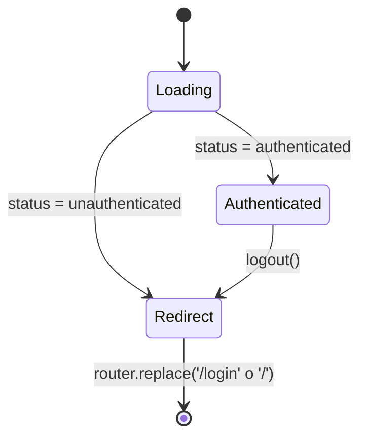

# Documento de Diseño

## Overview

Esta funcionalidad añade la Zona_Autenticada de "English Assistant": una página protegida servida en `/dashboard`, construida sobre Next.js 16 (App Router, React 19, Tailwind CSS v4). La página cierra el flujo de autenticación ya existente, ya que `/login` y `/register` navegan a `/dashboard` tras un acceso exitoso, pero esa ruta todavía no existe.

El diseño se apoya por completo en la infraestructura ya presente, sin tocar el backend:

- **Contexto_Auth** (`src/context/AuthContext.tsx`): ya expone `{ user, status, sessionExpired }` y las acciones `login`, `register`, `logout`. El `AuthProvider` ya envuelve toda la app desde `layout.tsx`, por lo que el dashboard solo necesita consumir el hook `useAuth()`.
- **UserOut** (`src/lib/api.ts`): el usuario autenticado ya incluye `first_name`, `last_name`, `email`, `english_level` y `created_at`, que es toda la información que el dashboard necesita mostrar.
- **Paleta de marca** (`globals.css`): variables `brand-900/700/500`, `accent-500/600`, `sky-soft`.
- **Componentes reutilizables**: `Logo` (acepta la prop `dark`).

### Decisiones de diseño clave

- **Protección de ruta en el cliente**: el dashboard es un client component que lee `status` del Contexto_Auth. Si `unauthenticated`, redirige a `/login` con `useRouter().replace()`. Mientras `loading`, muestra un indicador. La protección en servidor (middleware) queda fuera de alcance, coherente con que el token vive en `localStorage`/`sessionStorage` (no accesible en SSR).
- **Reutilizar el estado existente, sin llamadas nuevas**: el dashboard no llama a la API directamente; usa el `user` ya rehidratado por el `Contexto_Auth`. Esto evita duplicar la lógica de `getMe()` y mantiene una única fuente de verdad de la sesión.
- **Tarjetas con marcadores de posición**: como el backend aún no expone progreso ni actividad, las tarjetas muestran valores de marcador de posición claramente derivados de datos reales disponibles (p. ej. el nivel) o estáticos (progreso 0%). La estructura queda lista para conectar datos reales más adelante sin rediseñar.
- **Barra propia del área autenticada**: el dashboard usa su propia `Barra_Dashboard` (logo + cerrar sesión) en lugar del `Navbar` público, porque las acciones y el contexto son distintos (usuario autenticado vs. visitante).

## Architecture

### Vista general

```mermaid
graph LR
    subgraph Frontend["Frontend (Next.js 16)"]
        DashPage["/dashboard page.tsx"]
        DashBar["Barra_Dashboard"]
        Cards["Tarjetas de resumen"]
        AuthCtx["Contexto_Auth\n(useAuth)"]
        Router["useRouter"]
    end

    DashPage --> AuthCtx
    DashPage --> Router
    DashPage --> DashBar
    DashPage --> Cards
    DashBar --> AuthCtx
    AuthCtx -->|user, status| DashPage
    DashBar -->|logout| AuthCtx
    DashPage -->|replace('/login')| Router
```

### Máquina de estados de la página

La Pagina_Dashboard deriva su render del `status` del Contexto_Auth:



- **Loading**: `status === "loading"`. Se muestra un indicador de carga. Cubre el periodo de rehidratación del token al refrescar la página.
- **Authenticated**: `status === "authenticated"` y `user !== null`. Se renderiza el panel completo.
- **Redirect**: `status === "unauthenticated"`. Un efecto dispara `router.replace("/login")`. Durante el breve instante previo a la navegación se sigue mostrando el indicador de carga (nunca contenido protegido).

## Components and Interfaces

### Pagina_Dashboard — `src/app/dashboard/page.tsx`

Client component (`"use client"`). Responsabilidades:

- Consumir `useAuth()` para obtener `{ user, status, logout }`.
- Proteger la ruta: un `useEffect` observa `status`; cuando es `unauthenticated`, llama a `router.replace("/login")` (Requirements 1.2, 1.4).
- Mientras `status === "loading"` o `user === null`, renderizar `<DashboardLoading />` (Requirement 1.3).
- Cuando `authenticated`, renderizar `Barra_Dashboard`, el saludo y las tarjetas (Requirements 1.1, 3.1, 3.2, 4.1).

Boceto:

```tsx
"use client";
export default function DashboardPage() {
  const { user, status, logout } = useAuth();
  const router = useRouter();

  useEffect(() => {
    if (status === "unauthenticated") router.replace("/login");
  }, [status, router]);

  if (status !== "authenticated" || !user) return <DashboardLoading />;

  return (
    <div className="min-h-screen bg-sky-soft">
      <DashboardBar onLogout={() => { logout(); router.replace("/"); }} />
      <main>{/* saludo + tarjetas */}</main>
    </div>
  );
}
```

### Barra_Dashboard — `src/components/dashboard/DashboardBar.tsx`

Client component. Props: `{ onLogout: () => void }`.

- Muestra el `Logo` y un botón "Cerrar sesión".
- Al pulsar el botón, invoca `onLogout` (Requirements 2.1, 2.2).

### SummaryCard — `src/components/dashboard/SummaryCard.tsx`

Componente de presentación reutilizable para cada tarjeta de resumen. Props:

```ts
interface SummaryCardProps {
  icon: LucideIcon;
  title: string;
  value: string;
  caption?: string;
}
```

Renderiza una tarjeta con icono, título, valor destacado y una leyenda opcional. Se usa para componer el conjunto de tarjetas (Requirements 4.1, 4.2).

### DashboardLoading — subcomponente o bloque interno

Indicador de carga centrado (p. ej. un spinner o texto "Cargando…") que se muestra en los estados `loading` y durante la redirección (Requirement 1.3).

### Conjunto de tarjetas de resumen

Como mínimo (Requirement 4.1):

- **Nivel actual**: valor real = `user.english_level` (dato disponible).
- **Progreso**: marcador de posición `0%` con una barra de progreso (Requirement 4.2).
- **Actividad reciente**: marcador de posición (p. ej. "Aún no hay actividad").

El grid usa una columna en móvil y varias en escritorio mediante clases Tailwind (`grid-cols-1 md:grid-cols-3`) (Requirements 5.2, 5.3).

## Data Models

No se introducen modelos nuevos. El dashboard consume el tipo ya existente:

```ts
// src/lib/api.ts (existente)
interface UserOut {
  id: number;
  first_name: string;
  last_name: string;
  email: string;
  english_level: EnglishLevel; // "A1" | ... | "C2"
  created_at: string;
}
```

Los valores de las tarjetas que aún no provienen del backend se definen como constantes locales en la página, claramente marcadas como marcadores de posición.

## Error Handling

- **Sin sesión**: no es un error, es un estado. Se redirige a `/login` (Requirement 1.2). El aviso de sesión expirada ya lo gestiona el Contexto_Auth / la página de login mediante `sessionExpired`.
- **`user` nulo con `status === "authenticated"`**: situación transitoria imposible por el contrato del Contexto_Auth (solo pasa a `authenticated` tras poblar `user`). Aun así, el guard `!user` renderiza el indicador de carga como defensa.
- **Carga/redirección**: nunca se muestra contenido protegido mientras `status !== "authenticated"`.

## Testing Strategy

Dado que la lógica del dashboard es principalmente de presentación y control de flujo basado en estado (no hay funciones puras ni transformaciones de datos complejas), la estrategia se basa en **pruebas por ejemplo** con Vitest + @testing-library/react, consistentes con la infraestructura del spec de authentication. No se definen propiedades (property-based testing) porque no hay invariantes algebraicos sobre entradas variables; el comportamiento se expresa mejor con casos concretos de estado.

Casos clave:

- `status = "authenticated"` con un `user` → renderiza el saludo con `first_name`, el nivel y las tarjetas.
- `status = "unauthenticated"` → invoca `router.replace("/login")` y no renderiza contenido protegido.
- `status = "loading"` → renderiza el indicador de carga.
- Pulsar "Cerrar sesión" → invoca `logout()` y navega a `/`.

Todas las pruebas son opcionales (marcadas con `*` en el plan de tareas), coherente con el enfoque del spec de authentication.

## Correctness Properties

El comportamiento del dashboard es control de flujo derivado de un `status` discreto (`loading` | `authenticated` | `unauthenticated`) y renderizado de datos ya validados por el `Contexto_Auth`. El espacio de estados es finito y pequeño, por lo que la mayoría de la corrección se expresa como un conjunto cerrado de casos de ejemplo (ver Testing Strategy). Aun así, hay un invariante universal que vale para todo render y se formula como propiedad.

### Property 1: Invariante de protección de ruta

**Statement:** Para todo render de la Pagina_Dashboard, SI `status !== "authenticated"` ENTONCES no se muestra contenido protegido (saludo, barra ni tarjetas); solo se muestra el indicador de carga o se dispara la redirección.

**Rationale:** Esta propiedad es verdaderamente universal sobre el conjunto de valores de `status` y garantiza el requisito de seguridad central (la Zona_Autenticada nunca se filtra a sesiones no autenticadas). Se cubre verificando que, para cada valor de `status` distinto de `authenticated`, el DOM renderizado no contiene los elementos protegidos.

**Validates: Requirements 1.1, 1.2, 1.3**

Los demás comportamientos (redirección efectiva a `/login`, fidelidad del saludo y del nivel, y logout) se validan como casos por ejemplo porque dependen de estados concretos y no de entradas generadas; enumerarlos es más claro y completo que generar entradas aleatorias.

## Requirements Traceability

| Requirement | Componente / Mecanismo |
|---|---|
| 1.1 Mostrar panel si autenticado | `DashboardPage` render cuando `status === "authenticated"` |
| 1.2 Redirigir a `/login` si no autenticado | `useEffect` → `router.replace("/login")` |
| 1.3 Indicador de carga | `DashboardLoading` mientras `loading`/`!user` |
| 1.4 Redirigir tras `loading`→`unauthenticated` | mismo `useEffect` observando `status` |
| 2.1 Logo + Cerrar sesión | `DashboardBar` |
| 2.2 Logout → navegar a `/` | `onLogout` = `logout()` + `router.replace("/")` |
| 3.1 Saludo con `first_name` | bloque de saludo en `DashboardPage` |
| 3.2 Mostrar nivel | tarjeta "Nivel actual" = `user.english_level` |
| 4.1 Tarjetas de resumen | `SummaryCard` × N |
| 4.2 Marcadores de posición | constantes locales en progreso/actividad |
| 5.1 Paleta de marca | clases Tailwind `brand`/`accent`/`sky-soft` |
| 5.2 / 5.3 Responsive | grid `grid-cols-1 md:grid-cols-3` |
