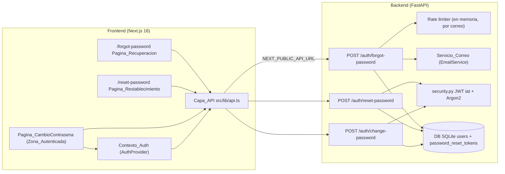
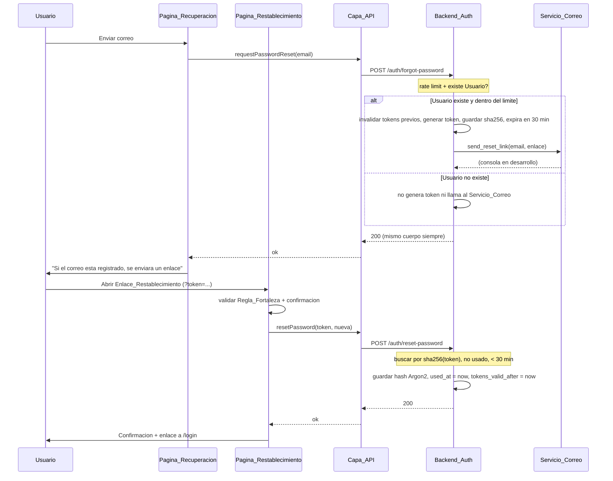
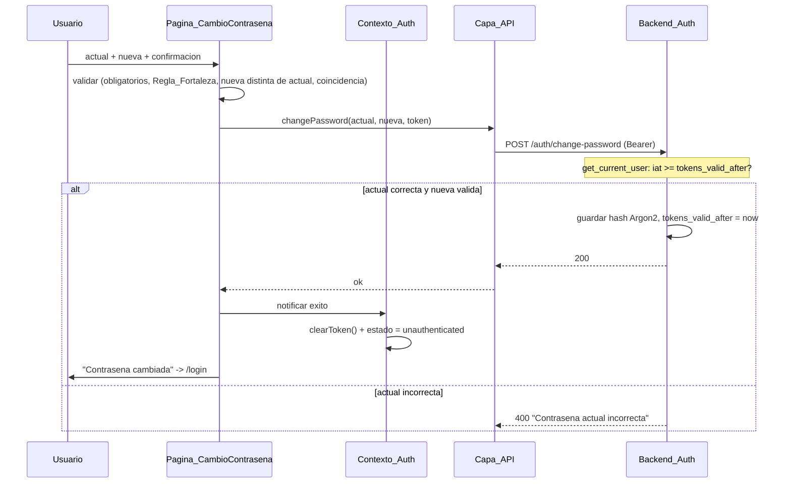
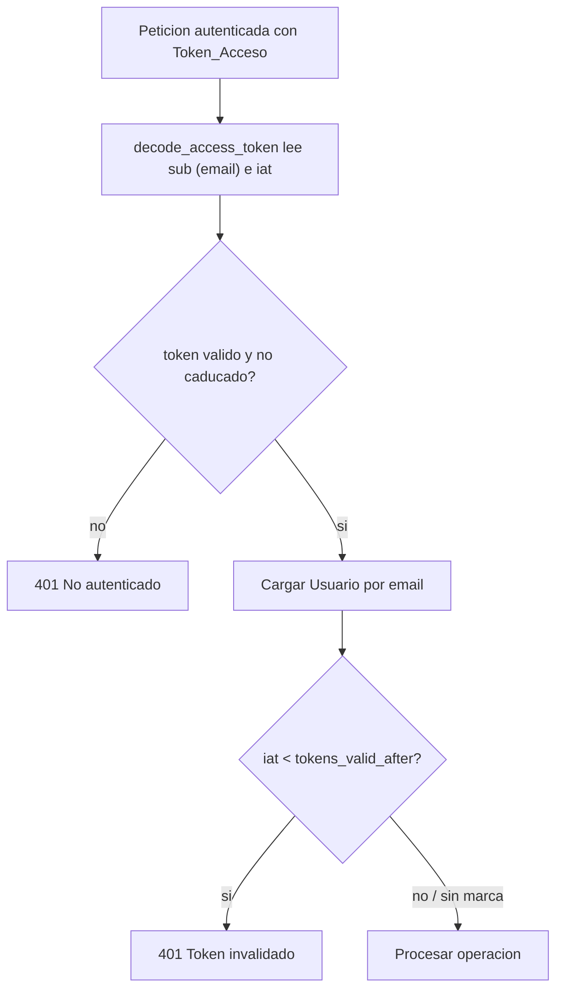
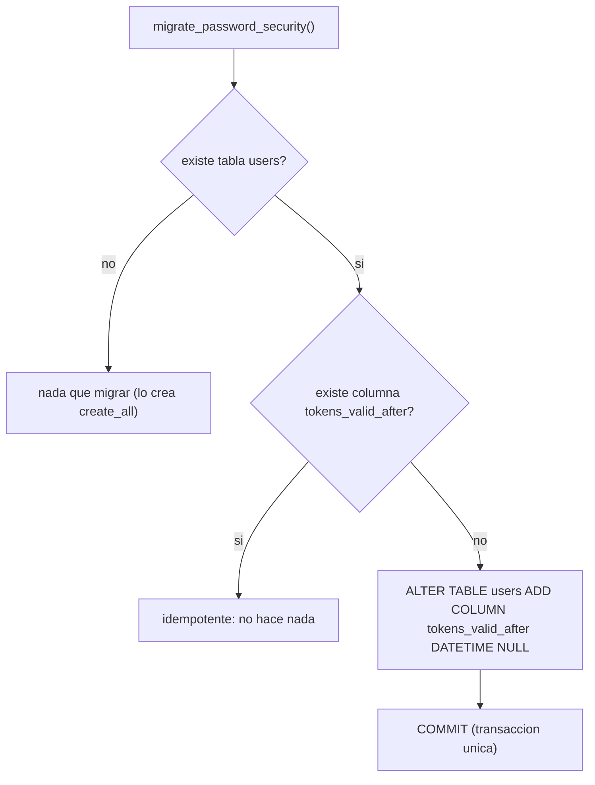

# Documento de Diseño

## Overview

Esta funcionalidad añade la **gestión de contraseña y seguridad de cuenta** a "English Assistant", sobre la autenticación ya existente (FastAPI + SQLAlchemy 2.0 sobre SQLite, hashing Argon2 con passlib, JWT HS256 de 30 minutos cuyo subject es el correo del Usuario; frontend Next.js 16 con App Router, React 19 y Tailwind CSS v4).

El alcance cubre tres capacidades y un mecanismo transversal de seguridad:

1. **Recuperación de contraseña por correo** (`/forgot-password` + `/reset-password`): el Usuario solicita un Enlace_Restablecimiento con su correo; el Backend_Auth genera un Token_Restablecimiento aleatorio de un solo uso y caducidad corta (30 min), almacena **solo su hash** y lo entrega a través del Servicio_Correo. Al abrir el enlace, el Usuario define una contraseña nueva que cumple la Regla_Fortaleza.
2. **Cambio de contraseña autenticado** (Pagina_CambioContrasena en la Zona_Autenticada): el Usuario con sesión iniciada introduce su contraseña actual y la nueva; el Backend_Auth verifica la actual antes de guardar el nuevo hash.
3. **Invalidación de sesiones activas**: al restablecer o cambiar la contraseña se actualiza la Marca_Invalidacion del Usuario, de modo que todo Token_Acceso emitido antes de ese instante se rechaza con 401.
4. **Anti-enumeración y rate limiting** sobre `/auth/forgot-password`, para no revelar la existencia de un correo ni permitir abuso.

El diseño se apoya en la infraestructura ya presente y la amplía de forma mínima:

- **Backend** (`backend/app`): se añaden tres endpoints bajo `/auth` (`forgot-password`, `reset-password`, `change-password`), un modelo `PasswordResetToken`, una columna `tokens_valid_after` en `User` (la Marca_Invalidacion), la inclusión de `iat` en el payload del JWT y un Servicio_Correo abstracto con una implementación de consola para desarrollo.
- **Frontend** (`frontend/src`): dos páginas nuevas (`/forgot-password`, `/reset-password`), una sección de cambio de contraseña en la Zona_Autenticada, tres funciones nuevas en la Capa_API y nuevas validaciones reutilizando `validation.ts`.

### Decisiones de diseño clave

- **Token de restablecimiento = valor aleatorio, no JWT**: se genera con `secrets.token_urlsafe(32)` (≥ 32 bytes de entropía). En base de datos se guarda **únicamente** su `sha256` (`token_hash`); el valor en claro solo viaja dentro del Enlace_Restablecimiento. Esto cumple el requisito de almacenamiento seguro (2.1, 2.2) y limita el impacto de una filtración de la base de datos.
- **Un solo uso + como máximo un token válido por Usuario**: cada registro tiene `used_at` (nullable). Al generar un token nuevo se invalidan los previos no usados y no caducados del mismo Usuario (2.6). Tras un `reset-password` exitoso se marca `used_at` (3.10).
- **Invalidación de sesiones por marca temporal, no por denylist**: se añade `iat` (instante de emisión, precisión de milisegundos) al payload del JWT y `tokens_valid_after` (Marca_Invalidacion) al Usuario. En `get_current_user`, si `iat < tokens_valid_after` el token se rechaza con 401 (5.5). `reset-password` y `change-password` exitosos fijan `tokens_valid_after = now()` (5.1, 5.2). Se evita una denylist por `jti` (fuera de alcance).
- **Servicio_Correo detrás de una interfaz abstracta**: `EmailService` (protocolo) con una implementación de desarrollo `ConsoleEmailService` que registra el Enlace_Restablecimiento en la consola del servidor (2.9). La integración real (SMTP/SendGrid/Resend) es futura y solo requiere otra implementación de la misma interfaz, inyectada por dependencia de FastAPI.
- **Anti-enumeración**: `/auth/forgot-password` responde **siempre** 200 con el mismo cuerpo, exista o no el correo; el trabajo (generar token + enviar) ocurre solo si el Usuario existe, y un fallo del Servicio_Correo no se revela (2.5, 2.8, 2.10).
- **Rate limiting en memoria por correo**: ventana deslizante de 15 min, máximo 5 peticiones; la 6.ª responde 429. Suficiente para esta etapa, con nota de que producción debería usar un almacén compartido (Redis).
- **La Regla_Fortaleza se valida también en el backend**: se replica en Pydantic (8–128 caracteres, ≥ 1 dígito, ≥ 1 mayúscula), no solo en el cliente (9).
- **Migración ligera sin Alembic**: `create_all` crea la tabla nueva `password_reset_tokens`, pero añadir la columna `tokens_valid_after` a la tabla `users` existente requiere un script de migración idempotente y transaccional al estilo de `migrate_user_names.py`.

## Architecture

### Vista general



### Capas del frontend

Se respeta la separación en tres capas ya establecida en el spec de autenticación:

1. **Capa de presentación** (`src/app/forgot-password/page.tsx`, `src/app/reset-password/page.tsx` y la Pagina_CambioContrasena en la Zona_Autenticada): reutiliza `AuthShell`, `FloatingField`, `ErrorBalloon` y `PasswordChecklist`. No habla directamente con HTTP.
2. **Capa de estado de sesión** (`Contexto_Auth`): tras un cambio de contraseña exitoso, elimina el Token_Acceso del almacenamiento y pone el estado en `unauthenticated` (6.10, 6.11).
3. **Capa de API** (`src/lib/api.ts`): se amplía con `requestPasswordReset`, `resetPassword` y `changePassword`, reutilizando el helper `request()`, la clase `ApiError` y la base `NEXT_PUBLIC_API_URL` existentes.

### Flujo de recuperación y restablecimiento (Requisitos 1, 2, 3, 5)



### Flujo de cambio de contraseña autenticado (Requisitos 4, 5, 6)



### Invalidación de sesiones por `iat` vs `tokens_valid_after`



## Components and Interfaces

### Backend

#### `security.py` — inclusión de `iat` en el token

`create_access_token` pasa a incluir el instante de emisión `iat` y `decode_access_token` devuelve el `sub` + `iat` para que `get_current_user` pueda comparar contra la Marca_Invalidacion.

```python
# app/core/security.py (estado objetivo)
from datetime import datetime, timezone

def create_access_token(subject: str) -> str:
    now = datetime.now(timezone.utc)
    expire = now + timedelta(minutes=settings.ACCESS_TOKEN_EXPIRE_MINUTES)
    payload = {
        "sub": subject,
        "exp": expire,
        "iat": now,          # instante de emisión (Requirement 5.4)
    }
    return jwt.encode(payload, settings.SECRET_KEY, algorithm=settings.ALGORITHM)

class TokenData(BaseModel):
    sub: str
    iat: datetime

def decode_access_token(token: str) -> TokenData | None:
    """Devuelve sub + iat, o None si el token no es válido/está caducado."""
    try:
        payload = jwt.decode(token, settings.SECRET_KEY, algorithms=[settings.ALGORITHM])
        return TokenData(sub=payload["sub"], iat=datetime.fromtimestamp(payload["iat"], tz=timezone.utc))
    except (JWTError, KeyError):
        return None

def hash_reset_token(token: str) -> str:
    """sha256 en hexadecimal del Token_Restablecimiento (Requirement 2.2)."""
    return hashlib.sha256(token.encode("utf-8")).hexdigest()
```

> **Nota de compatibilidad**: `GET /auth/me`, `POST /auth/login` y `POST /auth/register` existentes siguen funcionando igual. El único cambio observable del token es un claim `iat` adicional; los tokens ya emitidos sin `iat` se tratan como emitidos "en el origen del tiempo" (se rechazan solo si el Usuario tiene una Marca_Invalidacion posterior, que de inicio es `NULL` y por tanto no invalida nada).

#### `get_current_user` — comprobación de la Marca_Invalidacion

```python
def get_current_user(token=Depends(oauth2_scheme), db=Depends(get_db)) -> User:
    data = decode_access_token(token)        # None -> 401 (sin cambios)
    user = db.query(User).filter(User.email == data.sub).first()  # None -> 401
    # Requirement 5.5 / 5.6: rechazar si el token se emitió antes de la marca.
    if user.tokens_valid_after is not None and data.iat < user.tokens_valid_after:
        raise HTTPException(401, detail="La sesión fue invalidada. Inicia sesión de nuevo.")
    return user
```

#### Servicio_Correo (`app/core/email.py`)

Interfaz abstracta + implementación de consola para desarrollo, inyectada por dependencia.

```python
from typing import Protocol

class EmailService(Protocol):
    def send_reset_link(self, email: str, link: str) -> None: ...

class ConsoleEmailService:
    """Implementación de desarrollo: registra el Enlace_Restablecimiento en consola
    en lugar de enviar un correo real (Requirement 2.9)."""
    def send_reset_link(self, email: str, link: str) -> None:
        logger.info("Enlace_Restablecimiento para %s: %s", email, link)

def get_email_service() -> EmailService:
    """Dependencia FastAPI. La integración real (SMTP/SendGrid/Resend) sustituirá
    esta implementación sin tocar el endpoint."""
    return ConsoleEmailService()
```

#### Rate limiter (`app/core/rate_limit.py`)

Ventana deslizante en memoria, por correo, para `/auth/forgot-password`.

```python
class SlidingWindowRateLimiter:
    """Máx. 5 peticiones por correo en una ventana de 900 s (Requirements 7.1–7.3).

    Nota: el estado vive en memoria del proceso. En producción debe moverse a un
    almacén compartido (p. ej. Redis) para funcionar con varias instancias.
    """
    WINDOW_SECONDS = 900
    MAX_REQUESTS = 5

    def check(self, email: str, now: float) -> RateLimitResult:
        # 1) descartar marcas anteriores a now - WINDOW_SECONDS
        # 2) si len(restantes) >= MAX_REQUESTS -> bloqueado + retry_after
        # 3) si no -> registrar now y permitir
        ...

class RateLimitResult(BaseModel):
    allowed: bool
    retry_after_seconds: int   # 0 si allowed
```

> Para cumplir 7.4 (respuesta indistinguible entre correos existentes e inexistentes), el rate limiter se consulta **antes** de comprobar si el correo existe, usando siempre el correo normalizado como clave, de modo que el código 429 y su cuerpo no dependen de la existencia del Usuario.

#### Router `auth.py` — endpoints nuevos

```python
@router.post("/forgot-password", status_code=200)
def forgot_password(data: ForgotPasswordRequest, db=Depends(get_db),
                    email_service=Depends(get_email_service),
                    limiter=Depends(get_rate_limiter)) -> MessageResponse:
    # 1) rate limit por data.email -> 429 con Retry-After si se excede (7.3)
    # 2) buscar Usuario; si existe: invalidar tokens previos, crear token,
    #    guardar sha256 + expira en 30 min, llamar al Servicio_Correo (2.1-2.6)
    # 3) responder SIEMPRE el mismo cuerpo 200 (2.5, 2.8, 2.10)
    ...

@router.post("/reset-password", status_code=200)
def reset_password(data: ResetPasswordRequest, db=Depends(get_db)):
    # buscar por sha256(data.token); validar no usado y antigüedad <= 30 min.
    # Prioridad: token inválido/caducado/usado -> 400 antes que validar fuerza (3.11)
    # éxito: hashed_password = argon2(nueva); used_at = now; tokens_valid_after = now
    ...

@router.post("/change-password", status_code=200)
def change_password(data: ChangePasswordRequest,
                    current_user: User = Depends(get_current_user), db=Depends(get_db)):
    # get_current_user ya cubre 401 (token ausente/inválido/invalidado)
    # verify_password(actual) -> 400 si no coincide (4.9)
    # nueva != actual (4.4) y Regla_Fortaleza (validada por Pydantic)
    # éxito: hashed_password = argon2(nueva); tokens_valid_after = now
    ...
```

### Frontend

#### Capa_API (`src/lib/api.ts`) — funciones nuevas

```typescript
export interface ForgotPasswordInput { email: string; }
export interface ResetPasswordInput { token: string; new_password: string; }
export interface ChangePasswordInput { current_password: string; new_password: string; }

/** POST /auth/forgot-password -> responde siempre 200 con el mismo mensaje. */
export function requestPasswordReset(input: ForgotPasswordInput): Promise<MessageResponse>;

/** POST /auth/reset-password con { token, new_password }. */
export function resetPassword(input: ResetPasswordInput): Promise<MessageResponse>;

/** POST /auth/change-password con Authorization: Bearer <token>. */
export function changePassword(input: ChangePasswordInput, token: string): Promise<MessageResponse>;
```

Reutilizan el helper `request()` existente, por lo que heredan automáticamente: construcción de URL con `NEXT_PUBLIC_API_URL`, propagación de `detail` del backend en `ApiError`, mensaje genérico cuando no hay `detail`, y `ApiError(mensaje, null)` ante fallo de red (6.5–6.9). El timeout de 30 s (6.9) se añade al helper `request()` mediante `AbortController`/`AbortSignal.timeout(30000)`, aplicándose a todas las llamadas.

> **NEXT_PUBLIC_API_URL vacía (6.6)**: el helper `request()` comprobará que `baseUrl()` no esté vacío antes de hacer `fetch`; si lo está, lanzará `ApiError("La URL base del backend no está configurada.", null)` sin emitir la petición. Esta comprobación beneficia también a las funciones de autenticación existentes.

#### Contexto_Auth (`src/context/AuthContext.tsx`)

Se añade una acción para reflejar el cierre de sesión tras un cambio de contraseña exitoso:

```typescript
interface AuthContextValue {
  // ...existente...
  /** Tras un cambio de contraseña exitoso: limpia el token y pasa a no autenticado. */
  endSessionAfterPasswordChange: () => void;
}
```

La implementación reutiliza `resetSession(false)` (ya limpia `clearToken()` y pone `status = "unauthenticated"`), satisfaciendo 6.10 y 6.11. La Pagina_CambioContrasena la invoca al recibir el 200.

#### Páginas y subcomponentes

```
src/app/forgot-password/page.tsx   -> Pagina_Recuperacion (client component)
src/app/reset-password/page.tsx    -> Pagina_Restablecimiento (client component, lee ?token=)
src/app/dashboard/password/... o sección del dashboard -> Pagina_CambioContrasena (Zona_Autenticada)
```

Las tres páginas son client components (estado local, validación en vivo, acceso al Contexto_Auth) y reutilizan los componentes existentes: `AuthShell` (tarjeta + panel de marca), `FloatingField` (etiqueta flotante + ojo + globo de error), `ErrorBalloon` (errores "de uno en uno") y `PasswordChecklist` (requisitos en vivo de la Regla_Fortaleza).

La Pagina_Recuperacion incluye un enlace de regreso a `/login` (1.1) y la Pagina_Login cambia su enlace "¿Olvidaste tu contraseña?" para navegar a `/forgot-password` (1.2). La Pagina_Restablecimiento, ante un token ausente/ inválido, muestra un estado de "enlace inválido o caducado" con una acción para solicitar un enlace nuevo, sin mostrar el campo de contraseña (3.2).

#### Validaciones (`src/lib/validation.ts`) — reutilización y añadidos

- `validateEmail` → campo Correo de la Pagina_Recuperacion (1.3, 1.4).
- `validatePassword` / `passwordRequirements` → Regla_Fortaleza en Pagina_Restablecimiento y Pagina_CambioContrasena (3.3, 4.3).
- Se añade un helper puro `passwordsMatch(a, b): boolean` para la confirmación de contraseña (3.4, 4.5) y `isDifferentPassword(current, next): boolean` para "la nueva debe ser distinta de la actual" (4.4). Ambos son funciones puras verificables con fast-check.

## Data Models

### Modelo `User` — columna añadida (Marca_Invalidacion)

```python
class User(Base):
    __tablename__ = "users"
    # ...columnas existentes...
    # Marca_Invalidacion: todo Token_Acceso con iat < este instante es inválido.
    tokens_valid_after: Mapped[datetime | None] = mapped_column(
        DateTime, nullable=True, default=None
    )
```

- `NULL` significa "sin invalidación": ningún token se rechaza por antigüedad (estado inicial de todos los Usuarios).
- Se actualiza a `now()` (UTC) en cada `reset-password`/`change-password` exitoso (5.1, 5.2) y se conserva intacta ante cualquier fallo (5.3).

### Modelo `PasswordResetToken` (nuevo)

```python
class PasswordResetToken(Base):
    __tablename__ = "password_reset_tokens"

    id: Mapped[int] = mapped_column(Integer, primary_key=True, index=True)
    user_id: Mapped[int] = mapped_column(ForeignKey("users.id"), index=True, nullable=False)
    token_hash: Mapped[str] = mapped_column(String(64), unique=True, index=True, nullable=False)  # sha256 hex
    expires_at: Mapped[datetime] = mapped_column(DateTime, nullable=False)
    used_at: Mapped[datetime | None] = mapped_column(DateTime, nullable=True, default=None)
    created_at: Mapped[datetime] = mapped_column(DateTime, server_default=func.now())
```

Reglas:
- Se almacena `token_hash` (sha256 hex del valor en claro), **nunca** el valor en claro (2.2).
- `expires_at = created_at + 30 min` (2.4).
- Un token es **válido** si `used_at IS NULL` y `now() <= expires_at`. Es de un solo uso: al consumirse se fija `used_at` (3.7, 3.10).
- Al generar uno nuevo para un Usuario, los válidos previos de ese Usuario se marcan como usados/caducados para garantizar "como máximo 1 token válido por Usuario" (2.6).

### Esquemas Pydantic (`app/schemas/`) — nuevos

La Regla_Fortaleza se replica en el backend con un validador reutilizable (9):

```python
PASSWORD_MIN, PASSWORD_MAX = 8, 128

def validate_strength(value: str) -> str:
    if not (PASSWORD_MIN <= len(value) <= PASSWORD_MAX):
        raise ValueError("La contraseña debe tener entre 8 y 128 caracteres.")
    if not any(c.isdigit() for c in value):
        raise ValueError("La contraseña debe incluir al menos 1 número.")
    if not any(c.isupper() for c in value):
        raise ValueError("La contraseña debe incluir al menos 1 mayúscula.")
    return value

class ForgotPasswordRequest(BaseModel):
    email: EmailStr
    @field_validator("email")
    @classmethod
    def normalize(cls, v: str) -> str: return v.lower()

class ResetPasswordRequest(BaseModel):
    token: str = Field(min_length=1)
    new_password: str
    @field_validator("new_password")
    @classmethod
    def strength(cls, v: str) -> str: return validate_strength(v)

class ChangePasswordRequest(BaseModel):
    current_password: str = Field(min_length=1)
    new_password: str
    @field_validator("new_password")
    @classmethod
    def strength(cls, v: str) -> str: return validate_strength(v)

class MessageResponse(BaseModel):
    message: str   # cuerpo uniforme para forgot-password (anti-enumeración)
```

### Migración ligera sin Alembic

El proyecto usa SQLite + SQLAlchemy ORM sin Alembic; `Base.metadata.create_all` (en el `lifespan` de `main.py`) crea automáticamente la tabla nueva `password_reset_tokens`, pero **no** añade la columna `tokens_valid_after` a la tabla `users` ya existente.

Por ello se crea un script de migración idempotente y transaccional, al estilo de `app/db/migrate_user_names.py`:



- Usa `inspect(connection)` para comprobar la existencia de la columna antes de añadirla (idempotencia), y `engine.begin()` para que el `ALTER TABLE` sea atómico (COMMIT/ROLLBACK).
- No requiere poblar datos: la columna nace `NULL` (sin invalidación), que es exactamente el estado deseado para los Usuarios existentes.
- `password_reset_tokens` no necesita script: `create_all` la crea.

### API contract (resumen)

| Método | Ruta | Cuerpo entrada | Respuesta OK | Errores |
|--------|------|----------------|--------------|---------|
| POST | `/auth/forgot-password` | `{email}` | `200 {message}` (siempre el mismo) | `422` (formato correo), `429` (rate limit, con Retry-After) |
| POST | `/auth/reset-password` | `{token, new_password}` | `200 {message}` | `400` (token inválido/caducado/usado), `422` (Regla_Fortaleza) |
| POST | `/auth/change-password` | `{current_password, new_password}` (header `Authorization: Bearer`) | `200 {message}` | `400` (actual incorrecta), `401` (sin token / invalidado), `422` (Regla_Fortaleza) |

## Dependencias

- **Backend**: `secrets` y `hashlib` (biblioteca estándar) para generar y hashear el Token_Restablecimiento; `python-jose` (ya presente) para el claim `iat`; `passlib[argon2]` (ya presente) para el hash de la contraseña. `Hypothesis` + `pytest` como dependencias de desarrollo.
- **Frontend**: sin dependencias nuevas de runtime; reutiliza `fetch`, el helper `request()` y los componentes de `components/auth`. `fast-check` + `Vitest` + `@testing-library/react` como dependencias de desarrollo.
- **Integración futura (fuera de alcance)**: proveedor de correo real (SMTP/SendGrid/Resend) como implementación alternativa de `EmailService`; almacén compartido (Redis) para el rate limiting en despliegues multi-instancia.

## Correctness Properties

*Una propiedad es una característica o comportamiento que debe cumplirse en todas las ejecuciones válidas de un sistema: esencialmente, una afirmación formal sobre lo que el sistema debe hacer. Las propiedades son el puente entre las especificaciones legibles por humanos y las garantías de corrección verificables por máquina.*

Tras analizar cada criterio de aceptación y aplicar la reflexión de propiedades para eliminar redundancias, se consolidan las siguientes propiedades. Se descartan como propiedades los criterios de renderizado y de estado de UI (p. ej. 1.1, 1.2, 1.6–1.8, 3.1, 3.2, 3.6, 4.1, 4.8, 6.9–6.11), que se cubren con pruebas por ejemplo, y los de configuración (6.1, 2.9), que se cubren con smoke/example. La parte de *timing* de 7.4 no es verificable de forma determinista y se excluye.

### Property 1: Validación de formato de correo en recuperación

*Para todo* valor de cadena introducido en el campo Correo electrónico de la Pagina_Recuperacion, la función de validación marca un error si y solo si el valor está vacío/solo espacios (error de obligatoriedad) o no cumple el formato de correo electrónico (error de formato); cuando hay error, el formulario no puede enviarse.

**Validates: Requirements 1.3, 1.4**

### Property 2: Regla_Fortaleza en el cliente

*Para toda* cadena de contraseña nueva en la Pagina_Restablecimiento o la Pagina_CambioContrasena, `validatePassword` devuelve un error si y solo si la cadena incumple la Regla_Fortaleza (longitud menor que 8, mayor que 128, sin ningún dígito o sin ninguna letra mayúscula), e impide el envío en caso de error.

**Validates: Requirements 3.3, 4.3**

### Property 3: Reglas de pares de contraseñas (coincidencia y distinción)

*Para todo* par de cadenas (contraseña nueva, valor de confirmación) la validación marca el error "no coinciden" si y solo si las cadenas difieren; y *para todo* par (contraseña actual, contraseña nueva) de la Pagina_CambioContrasena la validación marca el error "debe ser distinta" si y solo si ambas cadenas son iguales. En ambos casos el error impide el envío.

**Validates: Requirements 3.4, 4.4, 4.5**

### Property 4: Fidelidad de la petición HTTP de gestión de contraseña

*Para toda* entrada válida de `requestPasswordReset(email)`, `resetPassword(token, newPassword)` o `changePassword(current, new, token)`, la petición emitida por la Capa_API usa la URL base de NEXT_PUBLIC_API_URL concatenada con la ruta correcta (`/auth/forgot-password`, `/auth/reset-password`, `/auth/change-password`), el método `POST`, un cuerpo JSON con exactamente los campos esperados (`{email}`; `{token, new_password}`; `{current_password, new_password}`) y, solo en `changePassword`, una cabecera `Authorization` igual a `Bearer ` seguido del token.

**Validates: Requirements 1.5, 3.5, 4.6, 6.2, 6.3, 6.4, 6.5**

### Property 5: URL base no configurada bloquea la petición

*Para toda* invocación de cualquier función de gestión de contraseña cuando NEXT_PUBLIC_API_URL está ausente o vacía, la Capa_API no emite ninguna petición HTTP y devuelve un error que indica que la URL base del backend no está configurada.

**Validates: Requirements 6.6**

### Property 6: Propagación del error del backend

*Para toda* respuesta del Backend_Auth con un código de estado de error, el error que devuelve la Capa_API contiene exactamente el valor del campo `detail` cuando este existe, y un mensaje genérico cuando el cuerpo no incluye `detail`.

**Validates: Requirements 6.7, 6.8**

### Property 7: Generación segura del Token_Restablecimiento

*Para toda* solicitud de recuperación cuyo correo corresponde a un Usuario existente, el Token_Restablecimiento generado tiene al menos 32 bytes de entropía (decodificado), se almacena únicamente como `token_hash = sha256(token)` (ningún campo contiene el token en claro) junto al `user_id`, y su instante de caducidad cumple 15 min ≤ `expires_at − created_at` ≤ 30 min.

**Validates: Requirements 2.1, 2.2, 2.4**

### Property 8: El Enlace_Restablecimiento entregado corresponde al token almacenado

*Para toda* solicitud de recuperación con correo existente, el Enlace_Restablecimiento entregado al Servicio_Correo tiene la forma `{FRONTEND_URL}/reset-password?token=T` donde `sha256(T)` es igual al `token_hash` del registro almacenado para ese Usuario.

**Validates: Requirements 2.3**

### Property 9: Como máximo un Token_Restablecimiento válido por Usuario

*Para toda* secuencia de solicitudes de recuperación para un mismo Usuario existente, tras procesar cada solicitud el número de Token_Restablecimiento válidos (no usados y no caducados) de ese Usuario es como máximo 1.

**Validates: Requirements 2.6**

### Property 10: Respuesta de recuperación indistinguible y sin efectos para correo inexistente o fallo de correo

*Para todo* correo electrónico con formato válido, la respuesta a `POST /auth/forgot-password` tiene el mismo código y el mismo cuerpo con independencia de si el correo corresponde a un Usuario existente; y *para todo* correo que no corresponde a ningún Usuario (o cuando la entrega del Servicio_Correo falla), no se crea ningún Token_Restablecimiento adicional ni se expone el fallo al solicitante.

**Validates: Requirements 2.5, 2.8, 2.10, 7.4**

### Property 11: Formato de correo inválido rechazado sin generar token

*Para todo* correo electrónico con formato inválido enviado a `POST /auth/forgot-password`, el Backend_Auth responde con un código 4xx y no crea ningún Token_Restablecimiento.

**Validates: Requirements 2.7**

### Property 12: Restablecimiento exitoso con token de un solo uso

*Para todo* Usuario con un Token_Restablecimiento válido (no usado, no caducado) y toda contraseña nueva que cumple la Regla_Fortaleza, la primera petición `POST /auth/reset-password` responde 200, guarda un hash Argon2 con el que la contraseña nueva verifica, y marca el token como usado; y toda petición posterior con ese mismo token responde 400 sin modificar la contraseña.

**Validates: Requirements 3.7, 3.10**

### Property 13: Rechazo de restablecimiento inválido con precedencia del token

*Para todo* Token_Restablecimiento inválido, caducado o ya usado, la petición `POST /auth/reset-password` responde 400 (indicación de token inválido o caducado) sin modificar la contraseña de ningún Usuario, incluso cuando la contraseña nueva también incumple la Regla_Fortaleza (se prioriza la validación del token sobre la de la contraseña); y *para todo* token válido con contraseña nueva que incumple la Regla_Fortaleza, la respuesta es un error de validación (422) sin modificar la contraseña.

**Validates: Requirements 3.8, 3.9, 3.11**

### Property 14: Cambio de contraseña exitoso

*Para todo* Usuario autenticado con un Token_Acceso válido, toda contraseña actual que coincide con su hash almacenado y toda contraseña nueva que cumple la Regla_Fortaleza y es distinta de la actual, la petición `POST /auth/change-password` responde 200 y guarda un hash Argon2 con el que la contraseña nueva verifica.

**Validates: Requirements 4.7**

### Property 15: Rechazo de cambio con contraseña actual incorrecta o nueva inválida

*Para toda* petición `POST /auth/change-password` autenticada cuya contraseña actual no coincide con el hash almacenado, el Backend_Auth responde 400 sin modificar la contraseña; y *para toda* petición cuya contraseña nueva incumple la Regla_Fortaleza o es igual a la actual, responde con un error (422 por fortaleza, 400 por igualdad) sin modificar la contraseña.

**Validates: Requirements 4.9, 4.11, 4.4**

### Property 16: Corte de validez del Token_Acceso por la Marca_Invalidacion

*Para todo* Token_Acceso (con `iat` presente en el instante de emisión) y toda Marca_Invalidacion del Usuario, una petición autenticada se rechaza con 401 sin modificar datos si y solo si el `iat` del token es estrictamente anterior a la Marca_Invalidacion; en caso contrario (y mientras el token no haya caducado) la petición se acepta y se procesa.

**Validates: Requirements 4.10, 5.4, 5.5, 5.6**

### Property 17: Actualización y conservación de la Marca_Invalidacion

*Para toda* operación de restablecimiento o de cambio de contraseña, la Marca_Invalidacion del Usuario se actualiza al instante de la operación (con precisión de milisegundos) si y solo si la operación se completa con éxito; si la operación falla, la Marca_Invalidacion previa se conserva sin cambios.

**Validates: Requirements 5.1, 5.2, 5.3**

### Property 18: Ventana deslizante del rate limiting

*Para toda* secuencia de instantes de solicitudes de recuperación asociadas a un mismo correo, el RateLimiter permite una nueva solicitud si y solo si el número de solicitudes previas dentro de los 900 segundos anteriores es menor o igual a 5; cuando la rechaza, lo hace con el código 429 e informa de un tiempo de reintento tras el cual el correo vuelve a estar por debajo del límite, y no se genera ningún Token_Restablecimiento para la solicitud rechazada.

**Validates: Requirements 7.1, 7.2, 7.3**

## Error Handling

### Frontend

La Capa_API sigue normalizando todos los fallos en `ApiError(message, status)`:

| Situación | `status` | Mensaje mostrado |
|-----------|----------|------------------|
| Recuperación OK (200) | — | Mensaje de confirmación indistinguible (no depende de si el correo existe) |
| Restablecimiento 400 | 400 | `detail` del backend: "El enlace de recuperación no es válido o ha caducado." → la página pasa a estado "enlace inválido o caducado" |
| Restablecimiento/Cambio 422 | 422 | `detail` del backend señalando la Regla_Fortaleza incumplida (red de seguridad; el cliente ya valida antes) |
| Cambio 400 (actual incorrecta) | 400 | "La contraseña actual no es correcta." |
| Cambio 401 (token invalidado/ausente) | 401 | El Contexto_Auth cierra sesión; se redirige a `/login` |
| Rate limit 429 | 429 | Mensaje con el tiempo de reintento tomado de `detail` |
| `fetch` lanza / timeout 30 s / URL base vacía | `null` | Mensaje de conexión o de configuración; conserva el valor del formulario y rehabilita el botón |

La validación en cliente (Regla_Fortaleza, coincidencia, obligatoriedad) bloquea el envío antes de llamar a la Capa_API; las respuestas de error del backend actúan como red de seguridad.

### Backend

- **422 (validación Pydantic / Regla_Fortaleza)**: formato de correo (`EmailStr`) en `forgot-password`; longitud de contraseña en `reset-password`/`change-password`; la exigencia de dígito y mayúscula se comprueba con `validate_strength`, devolviendo un `detail` que señala el campo.
- **400**: token de restablecimiento inválido/caducado/usado (con **precedencia** sobre la validación de la contraseña, Requirement 3.11); contraseña actual incorrecta; nueva igual a la actual.
- **401**: en `get_current_user`, token ausente/inválido o con `iat` anterior a la Marca_Invalidacion.
- **429**: rate limit superado, con tiempo de reintento en `detail`.
- **Indistinguibilidad (anti-enumeración)**: `forgot-password` responde siempre 200 con el mismo cuerpo exista o no el correo, incluso si el Servicio_Correo lanza (se captura y se registra, sin propagar). El rate limiting se aplica antes de consultar la existencia del correo para no filtrar información por la vía de la respuesta.
- **Migración**: el script `migrate_password_security` es idempotente y transaccional; si falla, hace ROLLBACK y no deja la tabla `users` en estado inconsistente ni pierde filas (solo añade una columna nullable).
- **Atomicidad de los efectos**: en `reset-password` y `change-password`, el guardado del nuevo hash, el marcado del token como usado y la actualización de `tokens_valid_after` ocurren en la misma transacción; si algo falla, se revierte y la Marca_Invalidacion previa se conserva (Requirement 5.3).

## Testing Strategy

Se adopta un enfoque dual, coherente con el spec de autenticación: pruebas basadas en propiedades para las propiedades universales anteriores y pruebas por ejemplo para renderizado de UI, estados y escenarios concretos.

### Librerías

- **Frontend (TypeScript)**: `fast-check` para propiedades, `Vitest` como ejecutor y `@testing-library/react` para componentes.
- **Backend (Python)**: `Hypothesis` para propiedades y `pytest` como ejecutor, con `TestClient` de FastAPI y SQLite en memoria. El `EmailService` y el `RateLimiter` se inyectan con dobles de prueba; el tiempo se controla inyectando un reloj (o parcheando `datetime.now`) para las propiedades temporales (caducidad, ventana deslizante, corte por `iat`).

### Configuración de las pruebas de propiedades

- Mínimo **100 iteraciones** por prueba de propiedad.
- Cada propiedad del diseño se implementa con **una única** prueba basada en propiedades.
- Cada prueba se etiqueta con un comentario:
  **Feature: password-management, Property {número}: {texto de la propiedad}**

### Cobertura de propiedades (property-based)

| Propiedad | Capa | Librería | Notas de generadores |
|-----------|------|----------|----------------------|
| 1 Validación de correo (recuperación) | Frontend | fast-check | Mezcla de correos válidos/ inválidos y cadenas en blanco |
| 2 Regla_Fortaleza en cliente | Frontend | fast-check | Cadenas 0..160 cubriendo fronteras 7/8/128/129, con/sin dígito, con/sin mayúscula |
| 3 Pares de contraseñas | Frontend | fast-check | Pares iguales/distintos para confirmación y para actual≠nueva |
| 4 Fidelidad de la petición | Frontend | fast-check | `fetch` mockeado; base URL, token, correo y contraseñas generados |
| 5 URL base no configurada | Frontend | fast-check | NEXT_PUBLIC_API_URL vacía/ausente × las 3 funciones; `fetch` espía (no llamado) |
| 6 Propagación de error del backend | Frontend | fast-check | status≥400 con/sin `detail` arbitrario |
| 7 Generación segura del token | Backend | Hypothesis | Correos existentes; inspección del registro guardado y de la caducidad (reloj inyectado) |
| 8 Enlace corresponde al token | Backend | Hypothesis | `EmailService` doble; parseo del token del enlace y comparación de hashes |
| 9 ≤1 token válido por usuario | Backend | Hypothesis | Secuencias de 1..n solicitudes para un usuario |
| 10 Indistinguibilidad y sin efectos | Backend | Hypothesis | Correos existentes vs inexistentes; `EmailService` que lanza; conteo de tokens y llamadas |
| 11 Correo inválido rechazado | Backend | Hypothesis | Correos mal formados; assert 4xx y 0 tokens |
| 12 Restablecimiento + un solo uso | Backend | Hypothesis | (usuario, token válido, contraseña fuerte); segundo intento con mismo token |
| 13 Rechazo + precedencia | Backend | Hypothesis | Tokens inválidos/caducados/usados × contraseñas fuertes/débiles |
| 14 Cambio exitoso | Backend | Hypothesis | (usuario, actual correcta, nueva fuerte ≠ actual) |
| 15 Rechazo de cambio | Backend | Hypothesis | actual incorrecta; nueva débil; nueva == actual |
| 16 Corte por `iat` | Backend | Hypothesis | Pares (iat, marca) alrededor de la frontera; reloj inyectado |
| 17 Actualización/conservación de la marca | Backend | Hypothesis | Operaciones exitosas y fallidas; comparación de `tokens_valid_after` antes/después |
| 18 Ventana deslizante | Backend | Hypothesis | Secuencias de timestamps dentro/fuera de 900 s; umbral 5 |

### Pruebas por ejemplo (unit / render)

- **Renderizado** (1.1, 3.1, 4.1): Pagina_Recuperacion muestra campo correo, botón y enlace a `/login`; Pagina_Restablecimiento con token válido muestra campos + ojo + botón; Pagina_CambioContrasena muestra los tres campos.
- **Estado de enlace inválido** (3.2): sin `token` o con 400, la Pagina_Restablecimiento oculta campos/botón y ofrece volver a `/forgot-password`.
- **Navegación** (1.2): el enlace del login lleva a `/forgot-password` (router mockeado).
- **Botón deshabilitado e indicación de carga** (1.7, 1.8, 3.6): con promesa pendiente, el botón queda `disabled` y se muestra el indicador.
- **Fallo/timeout de recuperación** (1.6, 6.9): `requestPasswordReset` rechaza/agota tiempo → permanece en `/forgot-password`, muestra error reintentable, conserva el correo y rehabilita el botón (timers falsos de Vitest).
- **Confirmación de cambio y cierre de sesión** (4.8, 6.10, 6.11): tras 200, se muestra confirmación y el Contexto_Auth queda `unauthenticated` con el token eliminado del almacenamiento.
- **ConsoleEmailService** (2.9): `send_reset_link` registra el Enlace_Restablecimiento en el logger y no realiza envío real.

### Pruebas de configuración / integración (smoke)

- **Exportaciones de la Capa_API** (6.1): `src/lib/api.ts` exporta `requestPasswordReset`, `resetPassword` y `changePassword`.
- **Migración** (modelo de datos): una prueba de integración ejecuta `migrate_password_security` sobre una BD sembrada sin la columna, verifica que `tokens_valid_after` queda añadida (nullable) y que re-ejecutarla no tiene efecto (idempotencia) ni pierde filas.
- **Creación de tabla**: `Base.metadata.create_all` crea `password_reset_tokens` al arrancar.
